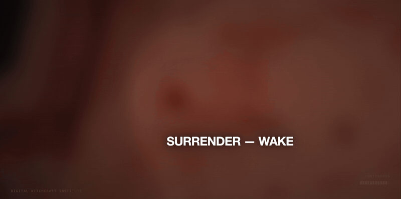
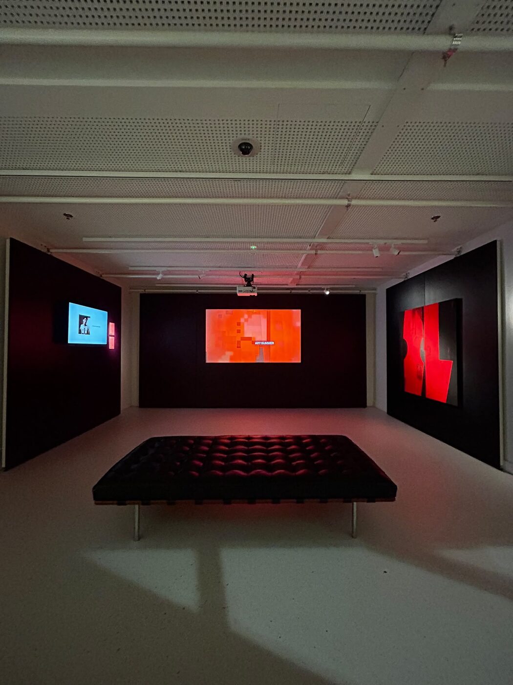
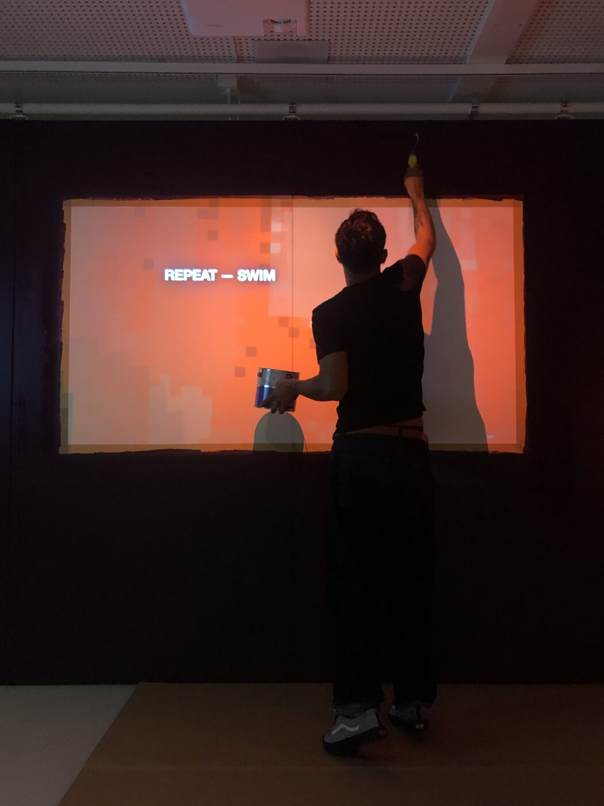

# Fiat

**An offline oracle for the creative act.**



Fiat is an offline machine that helps artists create. A small language model runs on one computer with no internet connection. It works on an artist's own archive: journals, notebooks, dream records. It gives no advice and suggests nothing from outside. It turns the artist's material into associations they would not have made, and answers in two forms at once: words from the artist's own vocabulary, and a moving field of colour that ranges from hard discrete cells to continuous flow.

Fiat is an object, not an app. It runs on a studio desk or in an exhibition room, on a household socket. Nothing leaves the machine.

Fiat is developed by the [Digital Witchcraft Institute](https://digitalwitchcraft.net), the studio of the artist [Danae Tapia](https://danaetapia.nl).

## What is in this repository

This is the working core of Fiat, as it runs in **Operational Closure** at De Nederlandsche Bank in Amsterdam. The installation is part of the exhibition *Of course studying art is a terrible idea* at De Nieuwe Schatkamer, from November 2026 to February 2027. It runs offline and unattended for three months.



The wall shows a two-word phrase composed from a closed lexicon. A language model running in the room reads one of the two words. Nothing the model writes is ever shown. It returns a reading: nine values that decide how the field behaves.

| Value | What it sets |
|---|---|
| `continuity` | 0 breaks the field into hard cells; 1 keeps it a smooth flow |
| `density` | how much of the frame is filled |
| `scale` | how close the field sits to the surface |
| `drift` | how fast it moves |
| `grain` | roughness of the surface |
| `temperature` | cold deep crimson to hot orange red |
| `weight` | sharp and brittle to soft and heavy |
| `symmetry` | asymmetric to mirrored |
| `source` | which source image gives the field its form |

The model is told to read with conviction. Countable, factual, institutional and brittle words push the field toward cells. Bodily, drifting and emotional words push it toward flow. The two historical traditions of artificial intelligence, symbolic and connectionist, become two states of one image.

The output is constrained to JSON, checked and clamped. If the model returns nothing usable, values derived from the phrase itself take over, so the wall never goes blank. A failure weakens the reading, never the piece.

The image is not generated. Three canvas layers redraw a source image at 12 to 640 cells, reduce it to luminance and remap it through a red ramp. CSS transforms move the layers on the graphics chip. The page has no dependencies and makes no requests outside the machine.

## Run it

You need a computer with 16 GB of memory (a Mac mini runs the installation), [Ollama](https://ollama.com), Python 3 and Chrome or Chromium.

```sh
ollama pull llama3.1:8b
cd oracle
python3 -m http.server 8000 --bind 127.0.0.1
```

Then open `http://127.0.0.1:8000` in Chrome. Press `f` for full screen and `c` to hide the labels.

Serve the folder from the local server. Opened as a `file://` page, the browser blocks the requests to Ollama and the images, and the field falls back to the phrase-derived values. The label in the top right corner says `OFFLINE / LOCAL WEIGHTS` when the model is reading and `RETRYING` when it is not.

To run it without a model, set `SOURCE: "demo"` in the `CONFIG` block of `oracle/index.html`.

To see the extremes on site without waiting for the model, call this from the browser console:

```js
__field("salt", {continuity: 0.05, temperature: 0.1, source: "a"})
```

## Make it your own

- **Words.** Replace the lists in `oracle/lexicon.js` with words from your own archive. The lexicon in this repository is a sample. The lexicon used at De Nederlandsche Bank comes from the artist's journals and stays with her.
- **Images.** Replace the files in `oracle/sources/`. They give the field its form only. The colour always comes from the red ramp. The images here are placeholders.
- **Model.** Change `OLLAMA_MODEL` in the `CONFIG` block. Any model in Ollama that returns JSON works. The installation uses Llama 3.1 8B.

## Running unattended

`install/macos/` holds a start script and a launch agent that start the server and Chrome at login and restart them if they stop. They are templates based on the setup at De Nederlandsche Bank. Adapt the paths and test them on your machine.

What kept the installation running for months:

- one machine, cold-booted once a day
- launch agents that keep Ollama, the server and the browser alive
- a separate Chrome profile with background throttling turned off
- a two-week soak test before installation, including pulling the plug
- a clone of the configured system on an external drive

## What comes next

In 2027 Fiat becomes a kit that any artist can install alone:

- loading a whole archive instead of a fixed lexicon
- choosing fragments by meaning, with a dial for how far the oracle reaches: close echoes of the current work, or distant material that still connects to it
- a written answer composed only from the artist's own vocabulary
- an installer and a manual for artists who do not code
- a move to an Apache-licensed model
- pilots with six artists from different regions

## Privacy

The page talks only to Ollama on the same machine. It keeps no record of what it shows or reads. There is no account, no telemetry and no training on the artist's material. The archive stays with its owner.

## Related work

- [The Witch and the Engineer](https://digitalwitchcraft.net/TheWitchAndTheEngineer/), a divinatory session at MozFest, Barcelona, 2026. The first of *The Industry's Prophets*.
- [The Cow](https://digitalwitchcraft.net/TheCow/), a divinatory session for the Division of Pension Supervision of De Nederlandsche Bank, November 2026. The second of *The Industry's Prophets*.
- [Digital Witchcraft Institute](https://digitalwitchcraft.net)
- [Danae Tapia](https://danaetapia.nl)



## Team

- Danae Tapia: concept and code
- Harry K. Pot: production, installation and code
- Julian Harty: testing

## Licence

The code is released under the [GNU General Public License v3.0](LICENSE). You can use, study, change and share it. Versions you distribute must stay open under the same licence.
